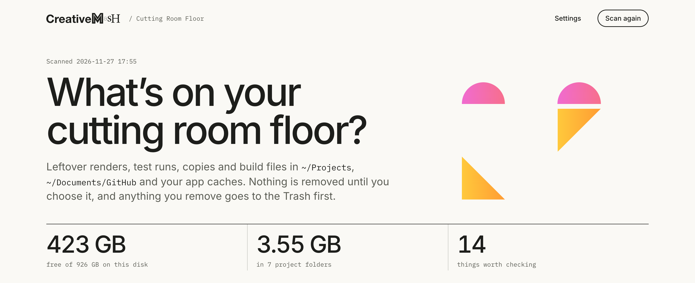
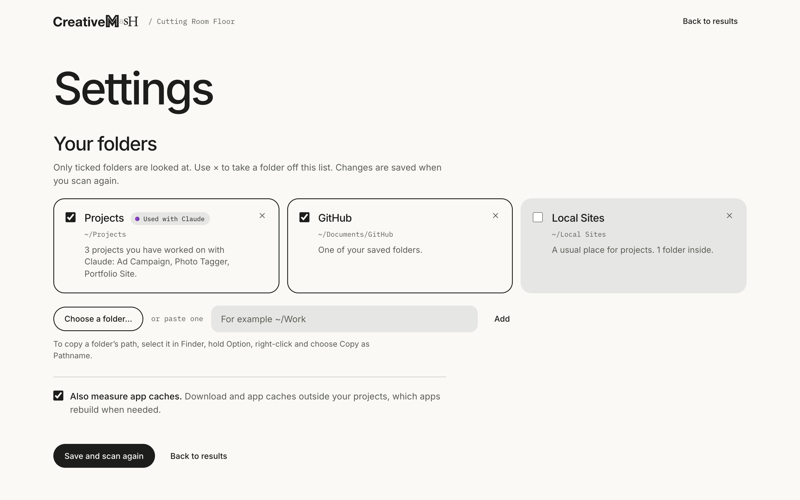
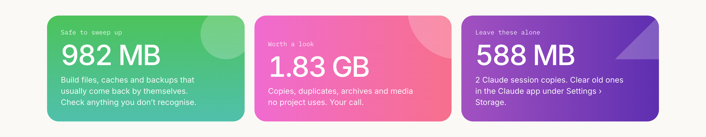
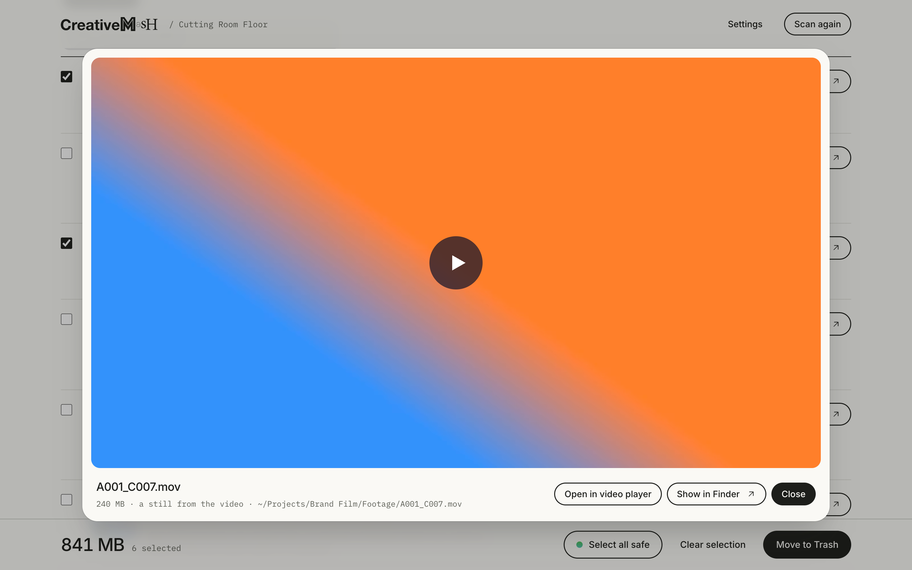
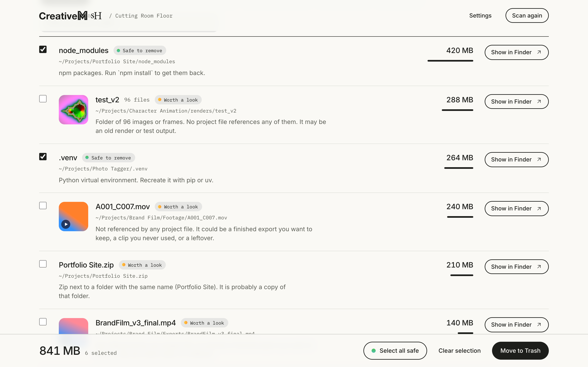

# Cutting Room Floor

**Sweep up the clutter AI leaves in your projects.**

A free tool by [Creative Mash](https://creativemash.ie). Works on macOS, Windows and Linux.



Making things with AI is fast, and it leaves a lot on the cutting room floor: test renders and variations nobody picked, exports that never made the final cut, copies of folders made "just in case", duplicate footage, build folders, session copies and caches. Over a few months that adds up to gigabytes.

Cutting Room Floor finds it across all your project folders, explains each item in plain words, and lets you tick what to sweep up, in one page.

- **Nothing is removed by the scan.** You choose in the page, confirm, and items go to the Trash (the Recycle Bin on Windows), so you can put them back.
- **Nothing about your files leaves your computer.** The page runs on your own machine at `127.0.0.1`, which no other device can reach. The only things it fetches from the internet are its fonts (from Google Fonts) and, when you check for updates, the latest version number (from GitHub).
- **Nothing to install** beyond Python 3.8 or newer.

> **Use at your own risk.** Cutting Room Floor suggests what you might remove; you decide, and you're responsible for what you remove. Check every item first and back up anything important. Once the Trash is emptied, files may be gone for good. Read the [disclaimer](#disclaimer) before you start.

## Use it with Claude Code

Open Terminal (on Windows, PowerShell) and run these two commands. This works whether you use Claude Code in a terminal or in the Claude desktop app:

```bash
claude plugin marketplace add CreativeMash/cutting-room-floor
```

```bash
claude plugin install cutting-room-floor@creativemash
```

Type them straight into Terminal, as they are. (Inside a running Claude Code session, after you've typed `claude`, the same thing is `/plugin marketplace add CreativeMash/cutting-room-floor` and `/plugin install cutting-room-floor@creativemash`. Those `/plugin` versions don't work in a plain Terminal or in the desktop app.)

Then start a new session and ask Claude in your own words, for example *"my Mac is running out of space"*, *"what can I delete in my projects?"* or *"what's on my cutting room floor?"*. Claude opens the page on the folder screen. The first time, it suggests folders (the projects you've worked on with Claude, plus usual places like `~/Projects` or `Documents\GitHub`); after that, your saved folders are ticked. Check them, press **Start the scan**, and Claude talks you through what it found.

### Getting updates

Updates don't install themselves unless you switch that on. To check, open **Settings** in the page and press **Check for updates**, or just ask Claude to *"update Cutting Room Floor"*. If there's a new version, press **Update now**: the page runs the update and shows what it's doing, then **Restart Cutting Room Floor** starts the new version and reloads the page.

To update by hand instead, run these two in Terminal (or PowerShell), in this order, then start a new Claude session. The first gets the latest list of versions; the second installs the newest one.

```bash
claude plugin marketplace update creativemash
claude plugin update cutting-room-floor@creativemash
```

To get updates automatically, type `/plugin` in Claude Code in a terminal, open **Marketplaces**, pick **creativemash** and turn on auto-update. Your saved folders are kept between updates.

## Use it without Claude

Download this repository (green **Code** button, then **Download ZIP**), unzip it, and run:

**macOS / Linux**

```bash
python3 skills/cutting-room-floor/cutting_room_floor.py
```

**Windows** (in PowerShell or Command Prompt, inside the unzipped folder)

```
py -3 skills\cutting-room-floor\cutting_room_floor.py
```

Your browser opens on a folder picker. Tick your project folders, or press **Choose a folder…** to pick one in Finder or Explorer, then press **Start the scan**. The results appear when it's done. Next time your folders are already ticked, so you can check them and press Start. There's a **Stop** button while it scans.

To update, download the ZIP again and replace the old folder (if you cloned it with Git, run `git pull` instead). Your saved folders are kept.

## Settings



Open **Settings** in the page's header to:

- **Change your folders.** Only ticked folders are scanned. Add one with **Choose a folder…** (it opens Finder or Explorer) or paste its location. Use × to take a folder off the list; suggested folders then stay hidden until you add them again.
- **Check for updates.** It asks GitHub for the latest version number, shows what's new, and explains how to update for the way you installed it. It never updates by itself. You can also have it check each time you open Cutting Room Floor.

## What it looks for



| | What | Why it's there |
|---|---|---|
| **Safe to remove** | `node_modules`, `.next`, `dist`, `build`, `.venv`, `__pycache__` and other build folders; Premiere auto-saves; Blender `.blend1` backups; package download caches | They rebuild or download again when needed |
| **Worth a look** | Folder copies (`Project copy`, `Project (2)`), archive folders, zips sitting next to the same folder, duplicate files, big media and image sequences that no project file mentions, app caches | Your call: some are leftovers, some are finished work |
| **Probably keep** | Media that a Premiere, Blender or code file refers to; WordPress uploads | Something uses them |

**"Safe to remove" is a strong hint, not a promise.** A build folder is only marked safe when the project file that rebuilds it sits next to it (a `package.json` beside `node_modules`, for example), a Python environment only when its requirements file is there, and a backup only when the main file still exists. Anything that fails those checks drops to "Worth a look". Even so, nobody knows your projects like you do, so check anything you don't recognise before removing it. When you remove something marked "Worth a look", the confirmation points it out.

Media counts as "in use" when a Premiere project, Blender file, After Effects project or code file in the scanned folders names it. Media used only by a project *outside* those folders shows as not in use, so check before removing.

Claude Code session copies (`.claude/worktrees`) are shown separately and can't be removed from the page. Clear old ones in the Claude app.

**See before you choose.** Images and videos have a thumbnail in the list. Click it for a bigger view, or press play to watch a video in the page. A folder of frames shows its first frame. On a Mac, most image types (including PSD, TIFF, HEIC and EXR) and MP4 and MOV videos get thumbnails; on Windows and Linux, PNG, JPG and WebP do. Videos your browser can't play, such as ProRes in Chrome, open in your usual video player instead.





## Options

```
--scan-now           scan your saved folders straight away, skipping the folder screen
--roots FOLDER ...   scan these folders this time, without changing your saved ones
--no-caches          skip app and download caches
--no-browser         don't open the browser automatically
--port N             starting port (default 8765; the next free one is used if taken)
--suggest            print suggested folders as JSON
--set-roots F ...    save folders without opening the page
--show-config        print your saved settings
--check-update       ask GitHub whether a newer version exists
--results            print the running scan's findings as JSON (add --wait to wait for the scan)
--version            print the version
```

Saved folders live in `~/.config/cutting-room-floor/config.json` on macOS and Linux, and `%APPDATA%\Cutting Room Floor\config.json` on Windows.

## Good to know

- Cloud-only files (OneDrive "Files On-Demand", iCloud "Optimise Mac Storage") take no room on your disk, so they count as zero and are never opened, which means they are not downloaded by the scan.
- Some things can't go to the Trash: anything on a network drive, and on Windows anything on a USB stick or too big for the Recycle Bin. The system would delete those for good, so they are marked "Can't go to the Trash" and can't be ticked.
- The page only answers requests from itself, on your own computer, with a secret key made fresh each time it starts. Other websites and programs can't read your results or remove anything.
- Thumbnails are made on your computer with its own tools (sips and Quick Look on a Mac) and kept in a temporary folder that's removed when Cutting Room Floor stops. Nothing is uploaded.
- Symlinks and Windows junctions are skipped, so nothing is counted twice and the scan never wanders off to another drive.
- On older macOS versions (before macOS 14), removing uses Finder, which may ask once for permission.
- On Linux, removing needs `gio` (part of most desktops) or `trash-cli`.

## Disclaimer

Cutting Room Floor is free software, provided "as is", without warranty of any kind (see the [MIT licence](LICENSE)). It points out files that *may* be safe to remove, but it can't know your projects the way you do, and it can be wrong.

- **You choose what to remove, and you are responsible for it.** Check every item before removing it, especially anything marked "Worth a look". If you're not sure what something is, leave it.
- **The Trash or Recycle Bin is the only safety net.** Removed items go there first so you can put them back, but once it's emptied they may be gone for good and impossible to recover.
- **Back up anything important before you start**, for example with Time Machine on a Mac, File History on Windows, or a copy on another drive.
- **Creative Mash accepts no liability** for any loss of data, work, time or money resulting from using this tool, to the extent the law allows.

By using Cutting Room Floor you accept these terms.

## Licence

MIT. Free to use, change and share. See [LICENSE](LICENSE).

Made by [Creative Mash](https://creativemash.ie).
